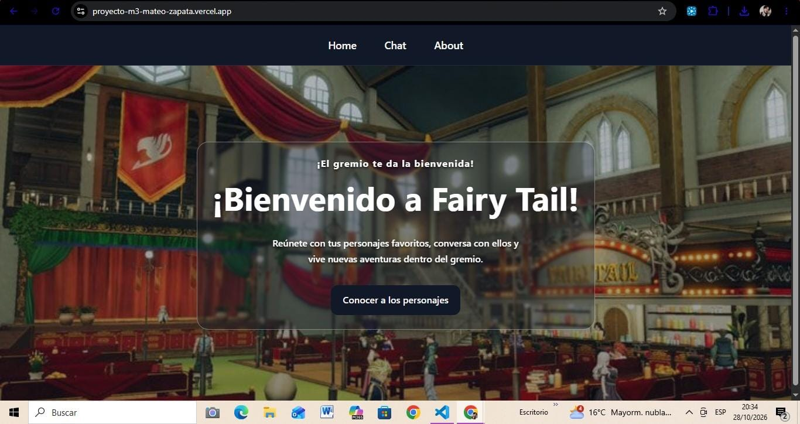
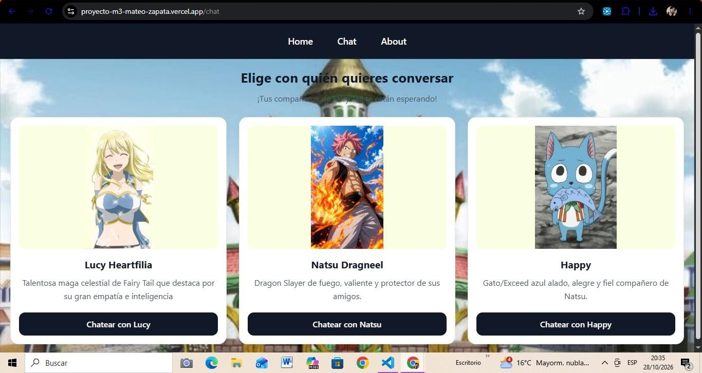
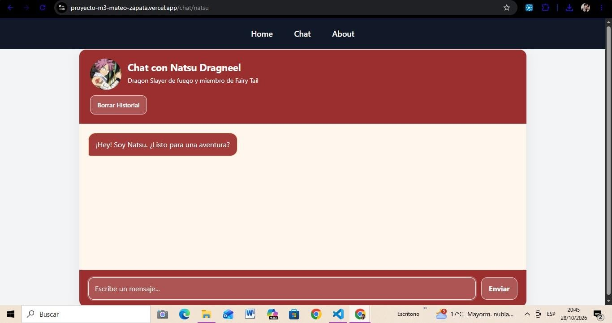
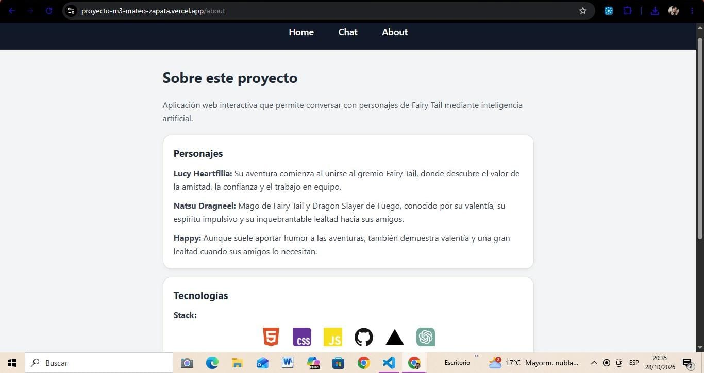

# Fairy Tail Chat 💫🔥

Aplicación web interactiva desarrollada como proyecto integrador, que permite conversar con personajes del universo de **Fairy Tail** mediante inteligencia artificial. A través de una interfaz sencilla e intuitiva, los usuarios pueden elegir entre Lucy Heartfilia, Natsu Dragneel y Happy, y mantener conversaciones inspiradas en sus personalidades.

El proyecto utiliza JavaScript vanilla para el frontend y Google Gemini para generar respuestas, integrando una función serverless de Vercel para gestionar las solicitudes de forma segura.

**Autor:** Mateo Zapata

**Repositorio:** https://github.com/Mattzap97/Proyecto-M3-Mateo-Zapata.git

**Aplicación desplegada:** https://proyecto-m3-mateo-zapata.vercel.app/

---

## ✨ Presentación del proyecto

**Fairy Tail Chat** es una prueba de concepto (POC) de una aplicación web que combina desarrollo frontend, navegación entre vistas e inteligencia artificial.

La aplicación permite seleccionar un personaje y acceder a una interfaz de chat para enviar mensajes y recibir respuestas generadas mediante Google Gemini, siguiendo instrucciones diseñadas para representar la personalidad de cada personaje.

El proyecto busca demostrar la integración de tecnologías web fundamentales con un servicio de inteligencia artificial, manteniendo una estructura organizada y una experiencia de usuario adaptable a diferentes dispositivos.

## 🎯 Objetivos del proyecto

- Desarrollar una Single Page Application (SPA) con JavaScript vanilla.
- Implementar navegación entre las vistas Home, Chat y About.
- Crear una interfaz para seleccionar personajes e iniciar conversaciones.
- Integrar Google Gemini para generar respuestas mediante inteligencia artificial.
- Gestionar las solicitudes al servicio de IA mediante una función serverless.
- Mantener las credenciales sensibles fuera del código del frontend.
- Implementar pruebas automatizadas para verificar las funcionalidades principales.
- Desplegar la aplicación en Vercel.

## 🧙 Personajes disponibles

### Lucy Heartfilia

Lucy es una maga celestial de Fairy Tail, inteligente, sensible y decidida, que sueña con convertirse en una escritora reconocida. 
Aunque al principio busca independencia y aventuras, encuentra en el gremio una familia que la ayuda a crecer. 
Su valentía, empatía y disposición a arriesgarse por sus amigos demuestran que su fuerza va mucho más allá de la magia.

### Natsu Dragneel

Natsu es un Dragon Slayer de Fuego impulsivo, apasionado y extremadamente leal a sus compañeros. 
Criado por el dragón Igneel, afronta desafíos con una determinación inquebrantable y nunca duda en proteger a quienes considera su familia.
A lo largo de sus aventuras, aprende el valor de la confianza, el trabajo en equipo y la fuerza que nace de sus vínculos.

### Happy

Happy es un Gato/Exceed azul, alegre, bromista y compañero inseparable de Natsu. 
Aunque suele aportar humor y aligerar los momentos difíciles, demuestra una gran valentía e ingenio cuando sus amigos están en peligro.
Su evolución refleja que, pese a no destacar por la fuerza física, su lealtad, capacidad de apoyo y cariño lo convierten en un miembro esencial de Fairy Tail.


La personalidad y comportamiento de los personajes están fielmente basados en el anime y manga. Además se definen mediante instrucciones enviadas al modelo de inteligencia artificial para orientar sus respuestas durante las conversaciones.

## 🛠️ Tecnologías utilizadas

- **HTML5:** estructura y contenido de las vistas.
- **CSS3:** estilos, diseño adaptable y presentación de los componentes.
- **JavaScript vanilla:** lógica de la aplicación y manipulación del DOM.
- **ES Modules:** organización del código en módulos nativos de JavaScript.
- **Google Gemini:** generación de respuestas mediante inteligencia artificial.
- **Vercel Serverless Functions:** procesamiento de solicitudes al servicio de IA desde el servidor.
- **Vercel:** alojamiento y despliegue de la aplicación.
- **Git y GitHub:** control de versiones y almacenamiento del código fuente.
- **Vitest:** ejecución de pruebas automatizadas, si corresponde a la configuración final del proyecto.

## 📁 Estructura del proyecto

La estructura general de referencia es la siguiente. Debe ajustarse a los nombres y archivos presentes en la versión final del repositorio.

```text

Proyecto M3-Mateo Zapata/
├── api/
│   └── chat.js
├── src/
│   ├── services/
│   │   ├── aiClient.js
│   │   ├── debounce.js
│   │   ├── fetchJson.js
│   │   ├── mockLucyApi.js
│   │   └── prompts.js
│   ├── transform/
│   │   └── chatPayload.js
│   ├── ui/
│   │   └── messages.js
│   ├── views/
│   │   ├── about.js
│   │   ├── chat.js
│   │   ├── home.js
│   │   └── notFound.js
│   ├── animations.css
│   ├── design.css
│   ├── main.js
│   ├── navigation.js
│   ├── router.js
│   ├── styles.css
│   └── utils.js
├── tests/
│   ├── chatApi.test.js
│   └── chatPayload.test.js
├── .env.example
├── .gitignore
├── index.html
├── package-lock.json
├── package.json
└── vercel.json

```

## 💻 Requisitos previos

Antes de ejecutar el proyecto, es necesario contar con:

- **Node.js:** versión compatible con las dependencias utilizadas.
- **npm:** administrador de paquetes incluido con Node.js.
- **Git:** para clonar el repositorio.
- **Cuenta de Google AI Studio:** para obtener una clave de API de Gemini.
- **Cuenta de Vercel:** para ejecutar el entorno local mediante Vercel CLI y realizar el despliegue.

Se recomienda revisar el archivo `package.json` para confirmar las dependencias y los comandos configurados.

## 🚀 Instalación y ejecución local

### 1. Clonar el repositorio

Abre una terminal y ejecuta:

```bash
git clone https://github.com/Mattzap97/Proyecto-M3-Mateo-Zapata.git
```

Ingresa a la carpeta del proyecto:

```bash
cd Proyecto M3-Mateo Zapata
```

### 2. Instalar las dependencias

Ejecuta:

```bash
npm install
```

Este comando instala las dependencias declaradas en `package.json`.

### 3. Configurar las variables de entorno

Crea el archivo `.env` a partir de `.env.example`, si este último se encuentra disponible:

```bash
cp .env.example .env
```

Si utilizas Windows y el comando anterior no funciona, puedes crear una copia del archivo desde el explorador de VS Code.

Consulta la sección de configuración para completar las variables necesarias.

### 4. Ejecutar la aplicación

Como el proyecto utiliza una función serverless de Vercel, puedes iniciar el entorno local con:

```bash
npx vercel dev
```

La primera vez, es posible que debas iniciar sesión o vincular el proyecto con Vercel.

Cuando el servidor esté listo, abre en el navegador la dirección indicada por la terminal. Habitualmente es:

```text
http://localhost:3000
```

Desde allí puedes recorrer las vistas Home, Chat y About, seleccionar personajes y comprobar las conversaciones.

## 🔐 Configuración de variables de entorno

La aplicación necesita una clave de API de Google Gemini para generar respuestas.

### Obtener una clave de API

1. Accede a [Google AI Studio](https://aistudio.google.com/apikey).
2. Inicia sesión con tu cuenta de Google.
3. Crea una clave de API.
4. Copia la clave generada y guárdala de forma segura.

### Configurar el archivo `.env`

En la raíz del proyecto, agrega la variable que espera la función serverless.

Por ejemplo, si el código utiliza `GEMINI_API_KEY`:

```env
GEMINI_API_KEY=tu_clave_real_de_gemini
```

**Importante:** el nombre de la variable debe coincidir exactamente con el que utiliza `api/chat.js`.

El archivo `.env` debe estar incluido en `.gitignore`. Nunca publiques tu clave de API en GitHub ni la incluyas en el código JavaScript que se ejecuta en el navegador.

## 🧪 Ejecución de pruebas

Si el proyecto tiene Vitest configurado en `package.json`, puedes ejecutar las pruebas con:

```bash
npm test
```

Para ejecutar las pruebas en modo watch, si existe el script correspondiente:

```bash
npm run test:watch
```

Las pruebas automatizadas permiten comprobar el comportamiento de las funciones evaluadas sin tener que revisar manualmente cada caso.

Se recomienda verificar los siguientes aspectos, según las pruebas implementadas:

- Funcionamiento de las funciones auxiliares.
- Comportamiento del cliente HTTP ante respuestas correctas y errores.
- Transformación de los mensajes enviados y recibidos.
- Manejo de respuestas de la función serverless.
- Validación de los casos de error contemplados por la aplicación.

Los comandos disponibles deben confirmarse en la sección `scripts` de `package.json`. Si Vitest no está instalado o configurado, esta sección deberá adaptarse antes de documentar las pruebas como funcionalidad implementada.

## ☁️ Despliegue en Vercel

La aplicación puede desplegarse en Vercel para ofrecer una versión pública accesible desde el navegador.

### Pasos para desplegar

1. Sube el proyecto a un repositorio de GitHub.
2. Accede a [Vercel](https://vercel.com/) e inicia sesión.
3. Selecciona **Add New → Project**.
4. Importa el repositorio de GitHub.
5. Revisa la configuración de despliegue y los ajustes de construcción según la estructura real del proyecto.
6. En la configuración del proyecto, accede a **Settings → Environment Variables**.
7. Agrega la variable `GEMINI_API_KEY` con su valor real y habilítala en los entornos que necesites.
8. Ejecuta el despliegue.
9. Abre la URL pública y comprueba que la aplicación y las conversaciones funcionen correctamente.

### Comprobaciones posteriores al despliegue

- La página principal se carga correctamente.
- La navegación entre Home, Chat y About funciona.
- Las tarjetas de los personajes se muestran correctamente.
- Se puede iniciar una conversación con cada personaje.
- Las solicitudes a Gemini reciben respuestas válidas.
- Los errores de conexión se gestionan adecuadamente.
- La aplicación funciona en computadoras, tablets y celulares.
- Las rutas se comportan correctamente al recargar la página.

**Aplicación desplegada:** https://proyecto-m3-mateo-zapata.vercel.app/

## 📸 Capturas de pantalla

En esta sección se incorporarán imágenes de las principales vistas de la aplicación para mostrar su diseño y funcionamiento.

### Home

Vista de bienvenida de Fairy Tail Chat.




### Selección de personajes

Vista donde el usuario puede elegir entre Lucy Heartfilia, Natsu Dragneel y Happy.



### Chat

Interfaz de conversación con uno de los personajes.



### About

Vista con información del proyecto, tecnologías utilizadas y créditos.




## 🔒 Seguridad y consideraciones

- La clave de API de Gemini debe mantenerse en variables de entorno del servidor.
- Las solicitudes a Gemini deben realizarse a través de la función serverless, evitando exponer credenciales en el frontend.
- El archivo `.env` no debe subirse al repositorio.
- La disponibilidad y el uso de Gemini dependen de la configuración de la API, sus límites y las condiciones del servicio.
- Las respuestas generadas por inteligencia artificial pueden contener errores o información imprecisa.

## ℹ Uso de la Inteligencia Artificial
Durante el desarrollo de la API se usó la IA como asistente y herramienta de apoyo para:

- Mejorar la interfaz de las tarjetas de personaje y evitar que las dimensiones de sus imágenes rompan el diseño de las mismas.
- Mejorar y complementar de manera precisa los prompts de los personajes basándose en la personalidad de cada uno.
- Mejorar sintáxis de código para reparar bugs innecesarios.
- Brindar mejor diseño para aportar a la experiencia de usuario al momento de navegar por la SPA.
- Corrección de sintáxis dentro del código implementado para ejecutar tests en vitest.
- Modularizar código innecesariamente repetido y que no afectaba la funcionalidad de la aplicación.

Los prompts utilizados y la evidencia visual de cómo la inteligencia artificial influyó para el desarrollo de este proyecto están documentados en

[Ver el documento del uso de la IA](src/Documentacion/Uso%20de%20la%20IA.md)


## 🙌 Créditos y agradecimientos

**Desarrollado por:** Mateo Zapata.

Este proyecto se creó con fines educativos y como una experiencia práctica de desarrollo web e integración de inteligencia artificial.

Los personajes, nombres y elementos relacionados con *Fairy Tail* pertenecen a sus respectivos titulares. La obra original fue creada por Hiro Mashima. Este proyecto es una iniciativa independiente y no está afiliado oficialmente a los titulares de la franquicia.

Se agradece a las herramientas, la documentación técnica, al instructor de Henry y los recursos de aprendizaje utilizados durante el desarrollo.

---

**Fairy Tail Chat** — Una forma de explorar el desarrollo web y la inteligencia artificial a través de los personajes de Fairy Tail.
